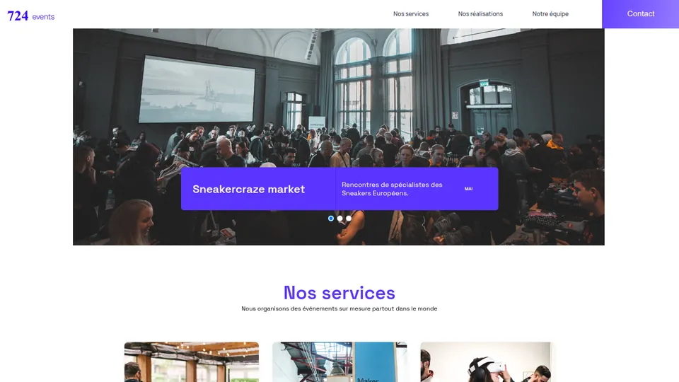

# 724 Events : débogage d'une application React

Projet 9 du parcours Développeur web d'OpenClassrooms : reprendre le site existant d'une
agence événementielle, trouver et corriger ses bugs, puis fiabiliser ses tests.



## Bugs corrigés

- Filtre des événements par catégorie qui n'avait aucun effet.
- Formulaire de contact : le message de confirmation ne s'affichait pas.
- Mois des événements décalés d'un mois.
- Carrousel : ordre des événements inversé, diapositive vide en fin de boucle et erreur dans
  la console.
- Dernier événement (pied de page) jamais affiché.
- Erreurs de la console React (propriétés de style SVG).

## Tests

Tests unitaires et d'intégration avec Jest et React Testing Library (16 fichiers de tests).
Les tests ignorés ont été réactivés et corrigés, et un cahier de recettes accompagne les
corrections.

## Stack

React, Sass, Jest, React Testing Library.

## Lancer en local

Le code se trouve dans le dossier `Debuggez-une-application-React.JS-main` (Node 16.14 ou plus
récent, Yarn) :

```
yarn install
yarn start
yarn test
```

---

Projet présenté dans mon portfolio : https://nicolas-grasser.vercel.app
